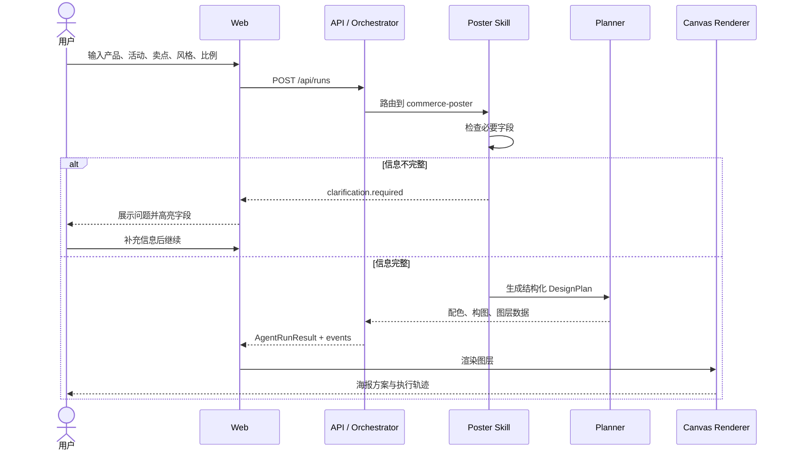

# 01 · 产品与交互流程

## 1. 主流程



## 2. 为什么必须追问

生成式产品常见错误是“信息不足时也强行生成”。这会导致结果看似完整，实际偏离业务目的。PosterPilot 只把三个字段设为硬要求：

| 字段 | 原因 | 追问方式 |
|---|---|---|
| 产品名称 | 决定视觉主体与主标题 | 这张海报要突出哪个产品？ |
| 活动主题 | 决定传播语气和信息层级 | 活动主题或时间节点是什么？ |
| 核心卖点 | 控制首屏只保留一个重点 | 用户最需要记住的卖点是什么？ |

风格和比例有默认值，因此无需阻塞执行。

## 3. Phase 1 页面布局

```text
┌─────────────────────────────────────────────────────────────────┐
│ PosterPilot                    Run 状态              Docs       │
├─────────────────┬─────────────────────────┬─────────────────────┤
│ 01 设计需求      │ 02 方案画布              │ 03 执行轨迹          │
│                 │                         │                     │
│ 产品名称         │     海报视觉预览          │ run.started         │
│ 活动主题         │                         │ skill.selected      │
│ 核心卖点         │     配色 / 图层 / 构图     │ tool.started        │
│ 风格与比例       │                         │ plan.created        │
│                 │ 设计说明                 │ canvas.updated      │
│ [运行 Agent]     │ 构图说明                 │ run.completed       │
└─────────────────┴─────────────────────────┴─────────────────────┘
```

## 4. 后续对话修改

Phase 3 将支持有限的画布修改指令，而非让模型直接生成任意 JavaScript：

```json
{
  "operation": "update_layer",
  "target": "product-name",
  "patch": {
    "content": "夏日轻盈新声",
    "fontSize": 38
  }
}
```

服务端必须校验 operation 白名单、目标图层是否存在、数值边界是否合理；校验通过后才更新画布并生成新版本。

## 5. 异常体验

- brief 格式错误：返回 `400 INVALID_BRIEF`，保留用户输入。
- Planner 输出非法：自动重试一次结构化生成；再次失败则展示可恢复错误。
- 图片任务超时：保留 DesignPlan，允许只重试图片工具。
- 浏览器刷新：未来通过 `runId` 恢复事件和最近画布版本。
- 用户取消：标记 `cancelled`，不覆盖最近成功版本。
