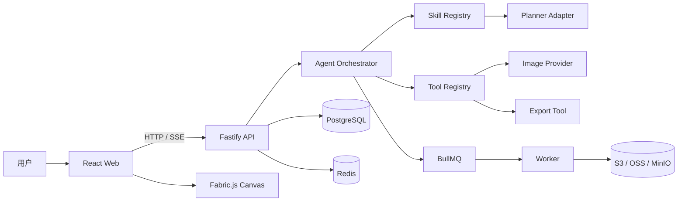

# 02 · 系统架构

## 1. 目标架构



Phase 1 只实现加粗主链条的最小替身：Web → API → Agent → Deterministic Planner → DOM Renderer。它保留未来替换点，但不提前引入数据库和消息队列。

## 2. 仓库结构

```text
poster-pilot/
├── apps/
│   ├── api/              # HTTP 边界、输入校验、未来 SSE
│   └── web/              # React UI、画布、执行轨迹
├── packages/
│   ├── agent/            # Skill、状态判断、Planner 编排
│   └── shared/           # 领域类型、事件协议
├── doc/                  # 设计和实施证据
├── package.json
└── pnpm-workspace.yaml
```

## 3. 边界职责

| 模块 | 负责 | 不负责 |
|---|---|---|
| Web | 收集输入、显示状态、渲染与编辑画布 | 保存 Provider 密钥、直接调用付费模型 |
| API | 鉴权、校验、速率限制、运行入口 | 直接写 UI 逻辑 |
| Agent | 状态迁移、Skill 选择、工具编排 | HTTP 细节、Canvas DOM |
| Shared | 稳定的数据契约 | 执行业务逻辑 |
| Worker | 长耗时图片/导出任务 | 同步请求中的交互逻辑 |

## 4. Skill 的工程含义

Skill 不是人格化名称，而是一组可测试约束：

```ts
interface SkillDefinition {
  id: string;
  inputSchema: Schema;
  requiredInformation: FieldRule[];
  plannerPrompt: string;
  allowedTools: ToolName[];
  outputSchema: Schema;
  retryPolicy: RetryPolicy;
}
```

`commerce-poster` 将限制：

- 只接受海报 brief。
- 缺失三个核心字段时必须追问。
- 输出必须符合 `DesignPlan`。
- 只能调用图片素材、画布操作、导出和版本工具。
- 工具调用次数和预算受限。

## 5. 为什么文本与视觉分开

图片模型不擅长稳定输出精确中文，因此目标方案是：

1. 图片模型只生成背景、产品氛围或装饰素材。
2. Planner 输出精确文字、层级和布局参数。
3. Fabric.js 在浏览器中渲染真实文字和可编辑图层。
4. 导出工具把画布合成为 PNG。

这样既保留生成能力，又让海报文字可控、可编辑、可搜索和可复用。

## 6. 安全与成本边界

- 所有 Provider 密钥只存在服务端环境变量。
- Web 中任何 `VITE_*` 都视为公开信息。
- API 按用户/项目限制并发、每日次数和单次工具预算。
- 模型返回值先过 Schema 校验，不直接执行模型生成代码。
- 对图片 URL、文件类型和大小做白名单校验。
- 所有关键工具调用写入事件和审计日志。
