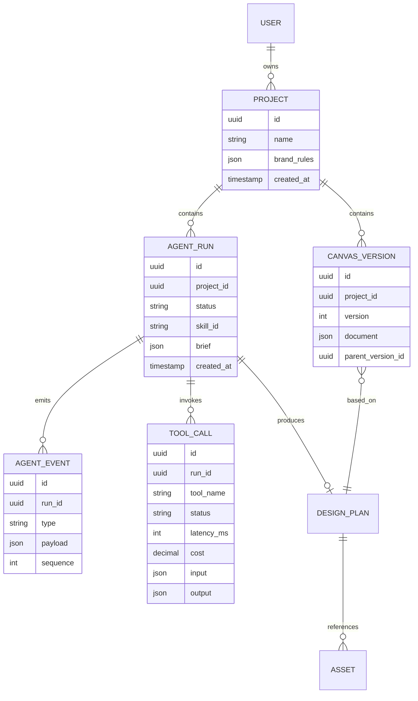

# 03 · 领域模型

## 1. Phase 1 核心对象

### PosterBrief

```ts
interface PosterBrief {
  productName: string;
  campaign: string;
  sellingPoint: string;
  style: "energetic" | "minimal" | "premium";
  ratio: "4:5" | "1:1" | "16:9";
}
```

它是用户意图经过 UI 收敛后的最小输入，不直接把一整段自然语言传给下游。

### AgentRunResult

```ts
interface AgentRunResult {
  runId: string;
  status: "waiting_for_user" | "succeeded" | "failed";
  skill: "commerce-poster";
  events: AgentEvent[];
  questions: ClarificationQuestion[];
  plan?: DesignPlan;
}
```

### DesignPlan

包含设计标题、方案理由、配色、构图说明和图层数组。它是 Planner 与 Canvas 的防腐层：即使未来更换模型或画布库，两边仍围绕这个稳定协议协作。

### DesignLayer

Phase 1 使用百分比坐标：

- `x/y/width/height` 范围为 0–100。
- `kind` 决定渲染器选择背景、产品、文本或按钮组件。
- 文本、颜色、字号等是白名单属性。

Phase 3 接入 Fabric.js 时将引入真实像素尺寸、旋转、字体、锁定状态和资源引用。

## 2. 目标数据库关系



## 3. 为什么 Run、Event、CanvasVersion 分开

- `AgentRun` 表示一次目标执行，适合展示状态和成本。
- `AgentEvent` 是追加式时间线，便于调试、SSE 恢复和审计。
- `CanvasVersion` 表示用户真正看到的作品状态，不能因一次失败 Run 被破坏。

一次 Run 可以失败，但最后成功的 CanvasVersion 必须仍可打开，这是生成式产品可靠性的关键。

## 4. 数据生命周期

1. 创建 Run 并保存 brief。
2. 逐个追加事件，不覆盖历史事件。
3. 每次工具调用保存输入摘要、状态、耗时和成本。
4. 方案生成后保存 DesignPlan。
5. 画布发生有效修改时创建新 CanvasVersion。
6. 导出文件作为 Asset 关联版本，使用带时效的下载 URL。

## 5. 隐私与保留策略

- 不把用户上传图像的永久公网 URL传给前端。
- 日志中不记录 API 密钥或完整鉴权头。
- 模型请求只携带完成任务需要的字段。
- 开源演示环境默认提供“一键删除项目与资产”。
- 正式上线前增加资产过期清理和日志脱敏任务。
