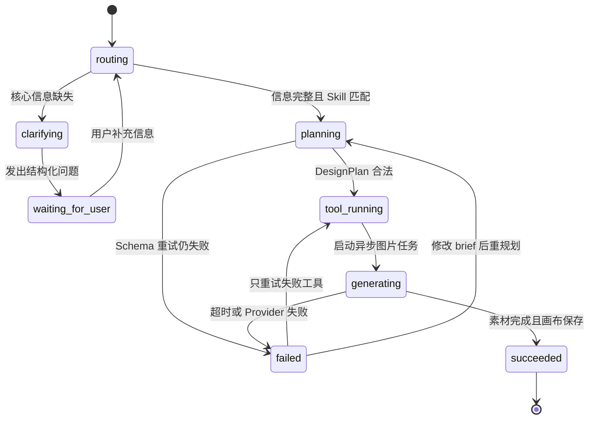

# 04 · Agent 状态机

## 1. 目标状态



Phase 1 实际状态简化为：

```text
routing → waiting_for_user
       ↘ planning → succeeded
```

## 2. 状态迁移表

| 当前状态 | 触发条件 | 下一状态 | 副作用 |
|---|---|---|---|
| routing | 缺少必填 brief | clarifying | 生成问题列表 |
| clarifying | 问题已输出 | waiting_for_user | 暂停，不调用付费工具 |
| waiting_for_user | 用户提交补充 | routing | 合并 brief 后重新校验 |
| routing | brief 完整 | planning | 选择 Skill 和 Planner |
| planning | 输出通过 Schema | tool_running | 保存 DesignPlan |
| tool_running | 长任务入队成功 | generating | 返回 taskId |
| generating | 所有必要资产成功 | succeeded | 创建 CanvasVersion |
| 任意执行态 | 不可恢复错误 | failed | 记录原因和可恢复动作 |

## 3. 追问策略

追问不是模型自由发挥。每个问题都包含：

- `field`：待补充字段。
- `question`：用户可理解的问题。
- `reason`：为什么需要它。

一次只追问当前任务真正缺失的字段，避免把表单换成冗长聊天。

## 4. Planner 合同

Planner 输入：标准化 `PosterBrief` + 可选品牌规范。

Planner 输出：必须通过 `DesignPlan` Schema，并满足业务约束：

- 图层 ID 唯一。
- 坐标和尺寸在合法范围。
- 至少一个主标题和一个产品视觉。
- 中文文本不嵌入生成图片。
- 颜色为合法值。
- 不出现未注册的工具调用。

## 5. 失败分类与恢复

| 类别 | 示例 | 自动处理 | 用户动作 |
|---|---|---|---|
| validation | brief 超长、枚举非法 | 不重试 | 修改输入 |
| planner_schema | 模型 JSON 不合法 | 用错误摘要重试 1 次 | 再次失败可重规划 |
| provider_rate_limit | 图片服务 429 | 指数退避，最多 2 次 | 稍后重试工具 |
| provider_timeout | 图片任务超时 | 标记工具失败，保留方案 | 换 Provider 或重试 |
| canvas_validation | 图层越界 | 自动裁剪或拒绝 patch | 恢复上个版本 |
| export | 字体或资源加载失败 | 等待资源后重试 | 下载旧版本 |

关键原则：只重试失败的最小步骤，不从头重复已经成功且付费的步骤。

## 6. 幂等性

- 创建 Run 接受 `Idempotency-Key`。
- 每个 ToolCall 有稳定 `toolCallId`。
- Worker 再次收到相同任务时先检查结果资产是否存在。
- 创建 CanvasVersion 以父版本和操作摘要去重。

这些设计将在接入真实 Provider 和队列时实现。
