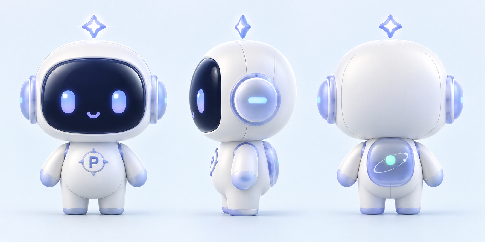

# PosterPilot 3D 助手精灵设计

## 1. 设计目标

为 PosterPilot 建立一个可以用于网站引导、运行反馈、空状态和未来三维动效的原创助手角色，并输出可供后续建模参考的正面、右侧面和背面三视图。

最终图片：

网站透明资产：

## 2. 参考图拆解

Pinterest 参考图提供的是风格方向，不是复刻目标。提取的规律包括：

- 超大圆润头部与很小的身体形成强识别度。
- 短手短脚和低重心让角色显得稳定、可亲近。
- 光滑玩具材质配合柔和棚拍光，产生高完成度的 3D 收藏玩具质感。
- 两侧功能模块和头顶小装饰形成轮廓记忆点。
- 大面积深色脸屏让简单眼睛也能表达情绪。

没有沿用参考角色的黑猫身份、猫耳、尾巴、耳机、四叶草、表情结构或标识。

## 3. 原创角色语言

### 身份

角色定位为“视觉领航助手”：负责陪伴用户梳理需求、生成方案并反馈任务状态，而不是拟人化设计师。

### 轮廓

- 头部：横向圆角矩形，呼应网站首屏悬浮设备。
- 身体：小型梨形躯干，比例约为整体高度的三分之一。
- 四肢：短而圆，保持玩具感和动画稳定性。
- 侧舱：贴合头部的圆形工具模块，不采用传统耳机头梁。
- 导航星：头顶悬浮四角星，表达方向、灵感与智能体状态。
- 背部面板：半透明轨道图形与薄荷绿状态灯，呼应网站的环绕动效。

## 4. 三视图说明

| 视图 | 需要表达的信息 |
| --- | --- |
| 正面 | 深蓝脸屏、发光眼睛、微笑、胸前 `P` 罗盘徽章、两侧工具舱 |
| 右侧面 | 头身厚度、脸屏弧度、侧舱直径、手臂和背部模块关系 |
| 背面 | 完整后壳、半透明轨道面板、状态灯、两侧舱背面结构 |

三个视图使用同一水平基线和相同角色高度，便于后续建立基础体块。真正进入三维生产前，仍应由建模人员补充顶视图、尺寸标注和关节转轴位置。

## 5. 色彩与材质

| 部位 | 建议颜色 | 材质 |
| --- | --- | --- |
| 主外壳 | 珍珠冰白 `#F7FAFC` | 柔触哑光硅胶或细腻喷涂塑料 |
| 透明边缘 | 冰川浅蓝 `#DCEAF2` | 磨砂半透明聚碳酸酯 |
| 发光结构 | 紫蓝 `#728AF1` | 半透明发光树脂 |
| 脸屏 | 深海军蓝 `#111B42` | 高光玻璃屏 |
| 状态灯 | 薄荷绿 `#72E3C0` | 柔和自发光材质 |

颜色来自当前网站的冰川浅蓝、紫蓝主色、深色交互面和绿色状态提示，保证角色放入页面后不会像外部素材。

## 6. 后续动效建议

- 待机：身体上下漂浮 4–6px，导航星与身体错峰运动。
- 思考：导航星缓慢旋转，侧舱出现一圈紫蓝呼吸光。
- 执行：眼睛向内聚焦，背部轨道灯加速一圈。
- 完成：眼睛形成上扬弧线，导航星弹性放大后回落。
- 等待补充：一只眼睛轻微眨动，状态灯从薄荷绿切换到暖黄色。

动效应继续遵守网站现有的轻幅度、慢漂浮和前快后慢缓动，不使用高频抖动。

## 7. 生成与文件记录

- 生成方式：内置图像生成工具。
- 用途类型：`stylized-concept`。
- 画布尺寸：`1774 × 887` PNG。
- 项目文件：`apps/web/public/assets/posterpilot-assistant-turnaround.png`。
- 网站透明资产：`apps/web/public/assets/posterpilot-assistant-front.png`，`1145 × 1374` RGBA PNG。
- 参考图角色只用于提取比例与材质规律，最终形象为独立设计。

## 8. 网站接入

### 介绍页

- 用透明正面角色替换原先的 CSS 抽象设备主体。
- 保留轨道、柔光、地面网格、状态胶囊和两张悬浮信息卡，让原有视觉语言继续成立。
- 角色保持 6 秒轻幅度漂浮，投影采用错峰呼吸，避免画面静止。

### 工作台

- 在“执行轨迹”的未运行状态展示缩小版精灵。
- 文案改为第一人称陪伴表达，让角色与智能体行为建立联系。
- 运行开始后漂浮速度提高；事件返回后由真实执行轨迹替换角色，不遮挡核心信息。

### 响应式边界

- 桌面端角色是介绍页右侧主视觉中心。
- 平板和手机端角色随动效场景整体缩放，不单独突破容器边界。
- 工作台角色使用相对尺寸和最大高度，避免在窄栏中过度占位。

## 9. 接入验收（2026-10-10）

| 检查项 | 结果 |
| --- | --- |
| 介绍页桌面端 | PASS：精灵、轨道、状态和悬浮卡片层级正确，无裁切或文字遮挡 |
| 介绍页手机端 `390×844` | PASS：主视觉跟随场景缩放，页面无横向溢出 |
| 工作台桌面端 `1470×737` | PASS：精灵完整位于执行轨迹空状态内，三栏仍在一个屏幕中展示 |
| 执行后状态切换 | PASS：真实问题或事件轨迹会替换空状态，不与精灵叠加 |
| 静态资源 | PASS：`/assets/posterpilot-assistant-front.png` 返回 `200 image/png` |
| 浏览器控制台 | PASS：warning/error 为 0 |
| 工程检查 | PASS：单测 2/2、类型检查、生产构建均通过 |

最终生成提示意图：从原创三视图中隔离完全一致的正面角色，保留造型、配色、材质和胸前 `P` 徽章，移除侧视图、背视图、背景与地面阴影，输出真实透明 Alpha 通道 PNG。接入时没有重新设计角色，只补充了网页中的尺寸、投影和轻漂浮动效。
